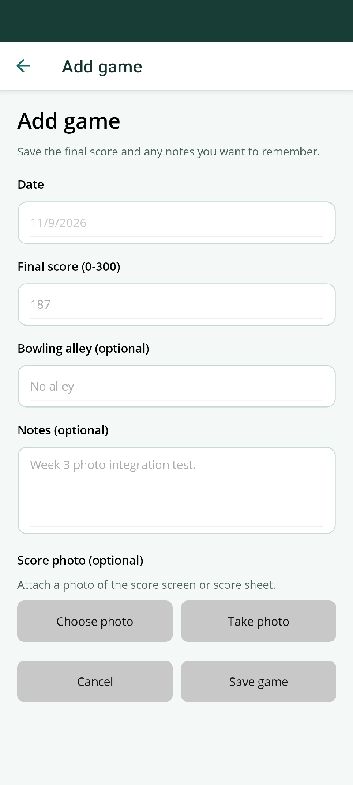
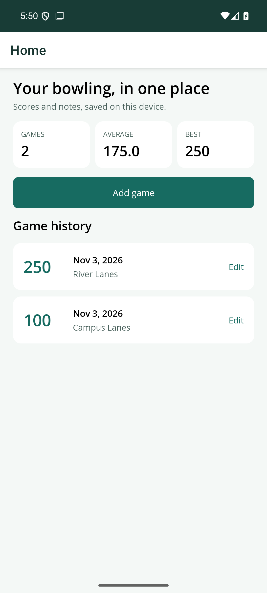
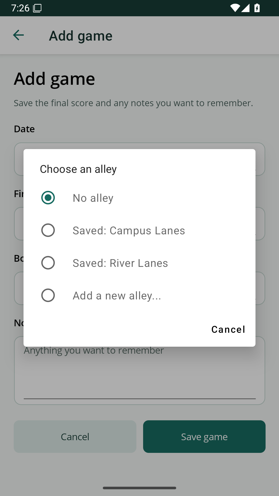

# Week 3 status: Photo integration

Matt Lewis | LaneLog | November 9, 2026

**Draft, not ready to submit.** The code for photo selection and camera capture is in place, but I have not verified either flow on Android. The PDF still needs screenshots of a completed photo selection.

## 1. Integration feature description

Integration: score-photo selection and camera capture using .NET MAUI's device media picker.

LaneLog records the final score and notes for each game. Attaching a photo of the score screen or score sheet gives the bowler another reference for that game. The feature is optional.

To use it, add or edit a game, choose or take a photo, check the preview, and save. You can replace or remove an existing photo. Cancel or Back discards the draft without changing the saved game.

## 2. Technical implementation

I use MAUI's `IMediaPicker`, so the app needs no extra media package, web service, or API key. The injected [PhotoService](../src/LaneLog.App/Services/PhotoService.cs) calls `PickPhotosAsync` with a one-photo limit or `CapturePhotoAsync` on the main thread. It reads the result with `OpenReadAsync` rather than relying on a permanent file path from the picker.

The [PhotoFileStore](../src/LaneLog.Core/Services/PhotoFileStore.cs) copies the image stream to a uniquely named file in the app's data directory. The editor previews that copy and stores its relative path in `BowlingGame.PhotoRelativePath` with the rest of the game in SQLite. LaneLog keeps an existing photo until the database update succeeds, then checks whether another game still uses it before deleting it. The original gallery image is left alone. If a saved photo is missing or its path is invalid, the editor shows a message and keeps the game.

The Android manifest declares camera access and makes camera and autofocus hardware optional. Android requests camera permission when capture is used. For selection, the installed MAUI 11 preview uses the Android system photo picker or an `ACTION_GET_CONTENT` fallback, so the app does not request broad image-library permission. The iOS and Mac Catalyst projects also have photo and camera usage descriptions, and Mac Catalyst has a camera entitlement, but those platforms have not been tested. App data can be included in system backups, and copied images may retain metadata.

I followed the course examples for dependency injection, MVVM commands, and app-data storage. Photo-file handling is in the Core project, so its storage behavior can be tested without an emulator.

## 3. Functional demonstration

Status: partially verified. On the Android 16 emulator, the photo actions appeared in the editor, and tapping **Choose photo** opened the system picker. I have not selected a photo or completed an Android save-and-reopen test.

The code supports:

- Choose or capture one photo, preview it, and associate it with a game.
- Replace or remove the draft attachment; preserve the saved photo until a successful update.
- Handle cancellation, unavailable camera or permissions, missing references, and file/storage errors with messages or diagnostic logging.

What I checked:

- The Android Debug build with the extension's DevFlow integration succeeded with 0 warnings and 0 errors.
- 18 core tests passed, including five new photo-file and SQLite-reference tests. The SQLite close/reopen test uses temporary files on the development machine; it is not an Android restart test.
- While the picker was open, the editor kept the score and note in the draft and disabled its actions.

I still need to select an image and check its preview, save the game, and reopen it after restarting the app. I also need to test camera capture, cancellation, denied permission, replacement and removal, and a missing saved file. I have not implemented recovery if Android closes the app while the picker is open.

## 4. Screenshots and evidence

Figure 1. Editor waiting for the photo picker. The score and note remain in the draft, and the photo actions are disabled while Android's picker is open. This shows LaneLog, not the picker.

Figure 2. Week 2 game history. This Android screenshot shows two saved games and their summaries after a restart. It predates the photo work.

Figure 3. Week 2 alley choices. The Add Game screen lists alley names from saved games.

For the final submission, I still need screenshots of Android's picker or camera, a selected-photo preview in LaneLog, and the relevant permission flow. The [verification log](verification/week-03/verification-log.md) lists the checks that remain.

## 5. Reflection

The picker may return a temporary file, so I could not safely save its path in the game record and assume it would still work later. `PhotoService` reads the image as a stream, and `PhotoFileStore` copies it to the app's data folder with a generated name. SQLite stores the relative path to that copy, and LaneLog leaves the gallery original alone.

I also had to keep photo changes in sync with the game record. The editor already uses a draft for scores and notes, so I used the same approach for photos. LaneLog keeps the saved photo until the database update succeeds. Before deleting it, the app checks whether another game still uses it. I added tests for path validation, failed copies, shared photo references, and reopening SQLite. Those tests cover the storage code, but they do not show whether the Android picker or camera works.

Getting the Android debug session running took troubleshooting. The first extension launches reported build failures without useful details. A build with the extension's DevFlow targets succeeded, but the emulator's broker tunnel was missing. Once I restored it, I could inspect the editor. The system picker runs outside LaneLog's visual tree, so my screenshot shows the app waiting for a result, not the picker.

I am most pleased that the integration fits the existing game record and uses MAUI's media picker without another package or a server. Before I can call it complete, I still need to choose and capture a photo, save the game, and reopen it after restarting the app. I also need to test cancellation, permission denial, replacement, removal, and a missing photo file. Recovery if Android closes the app while the picker is open remains unfinished. For Week 4, I plan to finish those Android checks and capture the required screenshots.

## Next week

After the photo checks, I plan to work on the proposed Settings screen and review accessibility and error handling.
