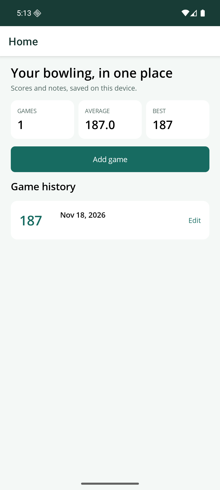
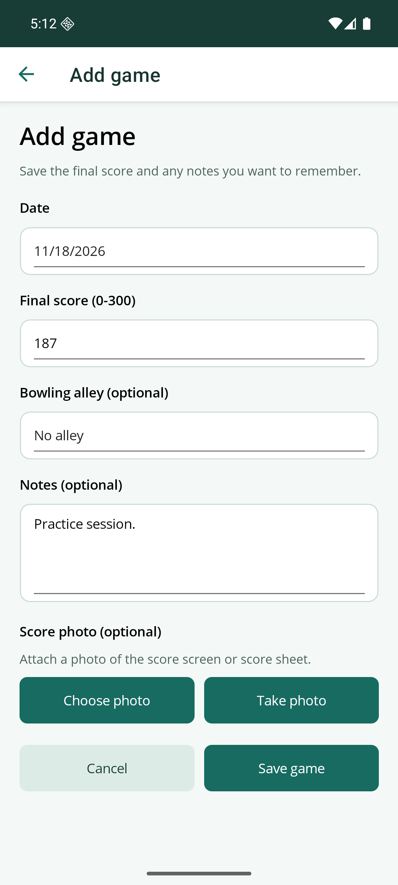
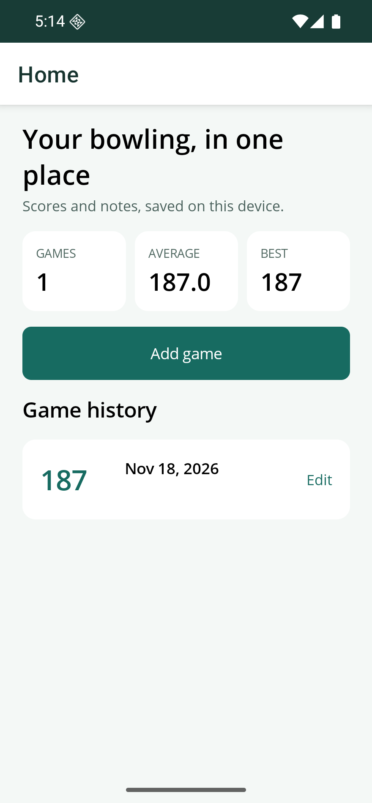
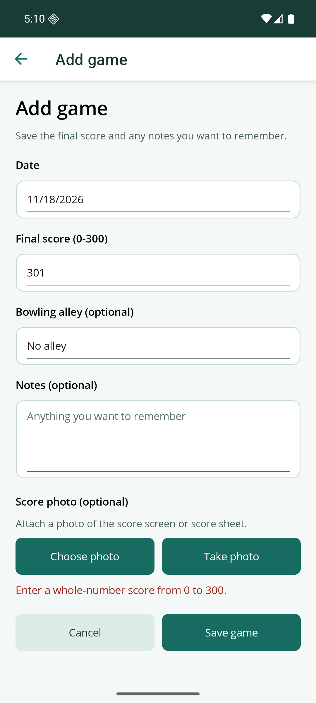
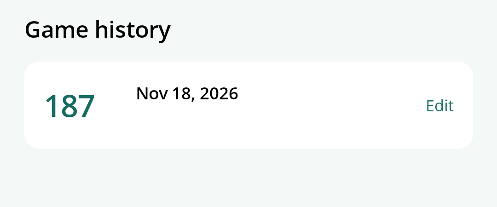

# Week 4 Status Update: UI Polish & User Experience Refinement

Matt Lewis | LaneLog | November 18, 2026

## Part 1: UI/UX Improvements Summary

I kept LaneLog's teal and green colors, then made the game history easier to scan and reused the same game card for every saved score. The Home screen still shows the game count, average, and best score above Add game. Each card shows the score, date, alley, and an Edit cue.

This week I moved the card into a `GameHistoryCard` ContentView and connected it to the typed CollectionView template. The card now has a stable automation ID and a screen-reader hint that it can be tapped to edit the game. I also limited the Home content to 840 device-independent units and the editor to 680, centering both on wider windows. The notes field grows as text is entered.

The app's statistics are still on Home; there is no separate Statistics page. Settings is not implemented.

## Part 2: Design & Accessibility Enhancements

The score field describes its 0-300 whole-number range to assistive technology. The date, alley, new-alley, and notes controls also have descriptions. Home's headings and loading indicator and the editor's photo preview already use semantic properties. The game card adds a hint to tap it to edit.

The editor's date, score, alley, and photo controls, as well as Save and Cancel, request at least 48 device-independent units. Notes has a 100-unit minimum height and grows with its content. The score input opens a numeric keyboard. The form labels identify optional fields, and a score outside the allowed range displays an error. On Home, a failed load shows a message and Retry rather than an empty history.

The Week 3 Android check measured the rendered light-theme score and notes text as black, with `#60756E` placeholders against white parent borders. The DatePicker and alley Picker showed `#212121` text. These are previous checks; I could not inspect the current build's properties or verify screen-reader behavior this week. The XAML defines light and dark colors, but dark-mode contrast and large-text behavior still need a device check.

## Part 3: Responsive Design & Custom Component

Home uses a Grid for the score summaries and game list. Each game card uses a Grid with a score column, a flexible details column, and an Edit cue. The editor keeps its form in a ScrollView inside a Grid. Its photo and Save/Cancel actions stay side by side. Safe-area and Android resize settings keep the form scrollable when the keyboard is open.

I added maximum widths of 840 for Home and 680 for the editor so their content stays centered rather than stretching across a wide window. I checked Home at the emulator's usual 1080 x 2400 resolution and at a temporary 880 x 1900 resolution (about 335 x 724 device-independent units). The main heading wrapped onto two lines at the narrower size; the summaries, Add game button, history card, and text remained visible without clipping. This was a second emulator viewport, not a separate device. Tablet, landscape, and large-text layouts still need testing.

### Reusable game card

`GameHistoryCard` is the reusable component. The typed CollectionView template supplies each saved `BowlingGame` as its binding context:

```xml
<CollectionView.ItemTemplate>
    <DataTemplate x:DataType="models:BowlingGame">
        <views:GameHistoryCard />
    </DataTemplate>
</CollectionView.ItemTemplate>
```

The card's XAML binds the score, date, and alley directly to that game. See [HomePage.xaml](../src/LaneLog.App/Views/HomePage.xaml) and [GameHistoryCard.xaml](../src/LaneLog.App/Views/GameHistoryCard.xaml) for the template and card markup.

The Home headings use `SemanticProperties.HeadingLevel`. Its typed `CollectionView.ItemTemplate` applies the `DataTemplate` to each game. Figures 1 and 5 show the current `GameHistoryCard` in the running app.

## Part 4: Screenshots & Evidence

These screenshots were captured on the Android 16 emulator on November 18. The Home screen contains one clearly labeled demo entry so the reusable history card is visible. The compact-layout screenshot uses a temporary emulator resolution; I restored the original resolution after capturing it.

### Figure 1. Home screen and game history

The screen shows one game, an average and best score of 187, and the reusable history card with its score, date, and Edit cue. The game is demo data entered for this screenshot.



### Figure 2. Add Game form

The filled form shows the score and notes fields together with the visible labels, optional-field wording, photo actions, and Save and Cancel buttons.



### Figure 3. Compact emulator layout

At 880 x 1900 pixels, the Home heading wraps while the summary cards, Add game button, history heading, and card remain visible without clipping. This is an emulator resolution override, not a test on a second physical device.



### Figure 4. Invalid-score feedback

Saving a score of 301 displays a message that states the allowed whole-number range. I corrected the draft before saving the demo game.



### Figure 5. Reusable game card detail

This closer view shows the score, date, and Edit cue in the reusable `GameHistoryCard` used by Home's typed CollectionView template.



## Part 5: Reflection

The history cards have the biggest effect on the way I use LaneLog. The score is easy to spot, and the date and alley are in the same place on every card. I moved that layout into a ContentView so the list can reuse it. The Home screen also keeps the game count, average, and best score where I can see them without opening another page.

The editor was harder to use with the Android keyboard open. It covered the bottom actions, so the form needed to scroll and the Android window needed to resize. In the earlier emulator check, I could scroll to Save and Cancel with the keyboard showing. This week I set maximum widths for Home and the editor to keep them from spreading too far on a larger window. I also checked a narrower emulator resolution: the Home heading wrapped, and the summaries, Add game button, and history card stayed visible. I have not checked a tablet, landscape orientation, or large text.

I added descriptions to the score, date, alley, new-alley, and notes controls and kept the visible labels. The controls and main actions request larger touch heights. The new validation screenshot shows the feedback for a score above 300. The earlier light-theme check recorded the text and placeholder colors, but I did not complete a screen-reader pass or a current dark-theme check.

I am proud of the reusable game card because it keeps the history rows consistent and gives the card a screen-reader hint. Before the final demo, I still need to check large text and screen-reader navigation and finish the Android photo flow. I have not confirmed that a selected or captured photo can be saved and reopened after restarting the app.

For Week 5, I will run the existing core tests and record the results, then check create, edit, cancel, restart, and navigation on Android. I also need to test photo selection, camera availability, cancellation, and errors. I will check TalkBack and large-text behavior and fix any issues that come up before the final demo.

## Verification Notes

The app ran on `MAUI_Emulator_API_36` (Android 16, `net11.0-android`). On November 18, I saved one demo game with a score of 187 and the note “Practice session”; Home showed one game, an average of 187.0, and a best score of 187. I also captured the 301 validation message and checked the compact emulator resolution described above. A DevFlow diagnostic found the Android broker reverse tunnel missing; restoring it brought the agent status and screenshots back. One visual-tree request returned a generic MCP error, so the updated visual tree and TalkBack behavior remain unverified. I did not rerun the Core unit tests or photo-flow checks for this update.

The prior [Week 2 verification log](verification/week-02/verification-log.md) and [Week 3 verification log](verification/week-03/verification-log.md) contain their own test and device results. The Week 3 test results were not rerun for this UI change.
